# spent-time

Run 2026-10-22T17:15:04.857Z against http://127.0.0.1:3000.

| screenshot | user | URL | shows |
|---|---|---|---|
|  | manager | `/issues/26` | Recurrence #26: the Recurrences panel shows the total of the whole series (template, 2 recurrences, their subtasks and a follow-up subtask added by hand) |
| 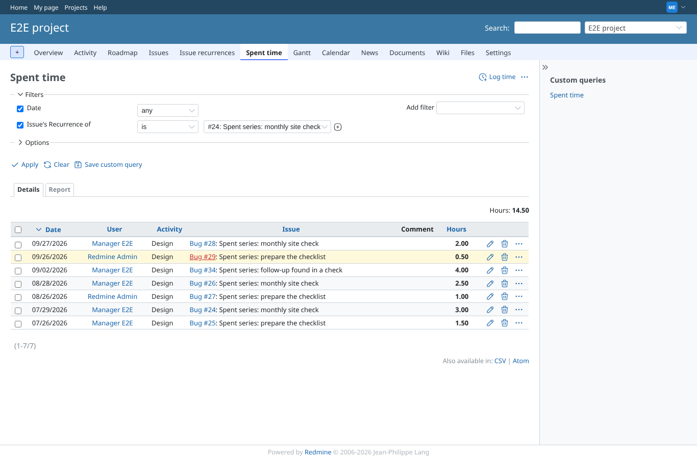 | manager | `/projects/e2e-project/time_entries?issue.recurrence_of=24` | The link opens Spent time with the filter "Issue's Recurrence of is #24": same 14.50 h, 7 entries |
| 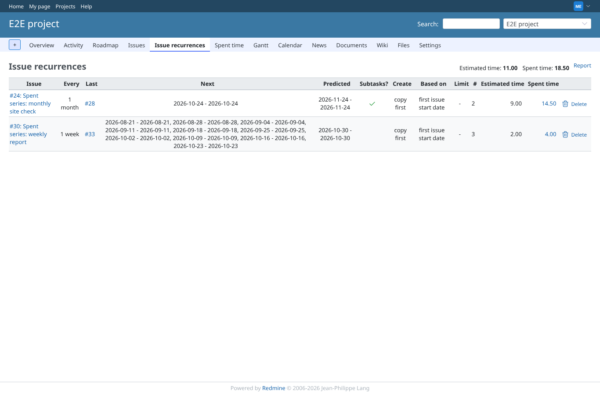 | manager | `/projects/e2e-project/recurrences` | Module tab: Estimated time and Spent time per recurring issue, totals above the list, link "Report" top right |
| 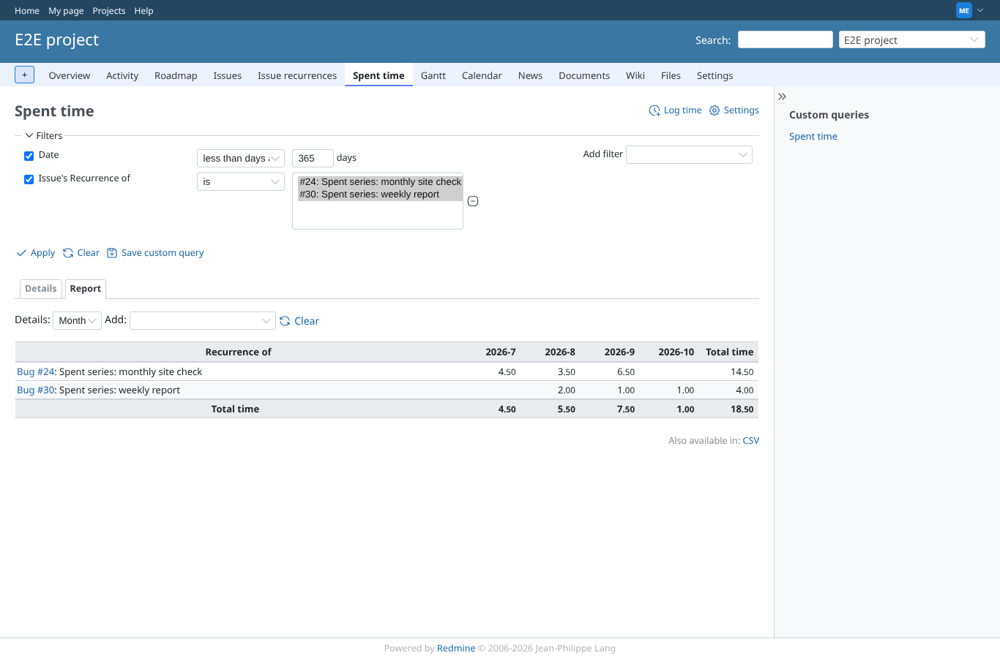 | manager | `/projects/e2e-project/time_entries/report?columns=month&criteria%5B%5D=recurrence_of&issue.recurrence_of=24%7C30&spent_on=%3Et-365` | The link opens Spent time > Report: one row per recurring issue, a column per month over the last 365 days, core's own period filter |
| 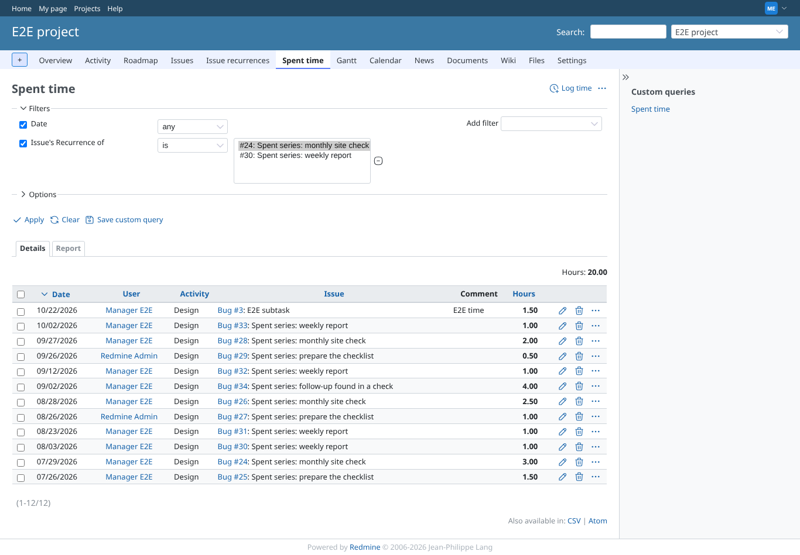 | manager | `/projects/e2e-project/time_entries` | Spent time: the filter "Issue's Recurrence of" lists the recurring issues the user can see |
| 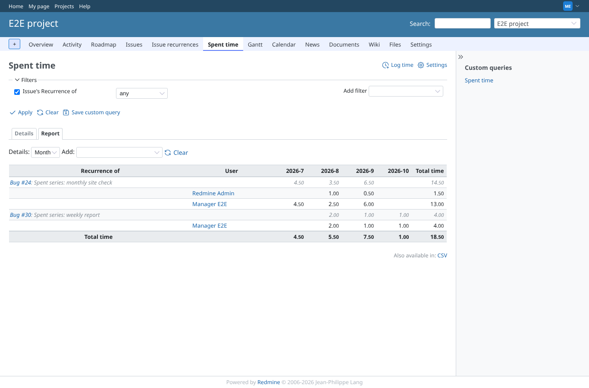 | manager | `/projects/e2e-project/time_entries/report?set_filter=1&f[]=issue.recurrence_of&op[issue.recurrence_of]=*&criteria[]=recurrence_of&criteria[]=user&columns=month&spent_on=*` | Report: rows per recurring issue, then per user, columns per month |
| 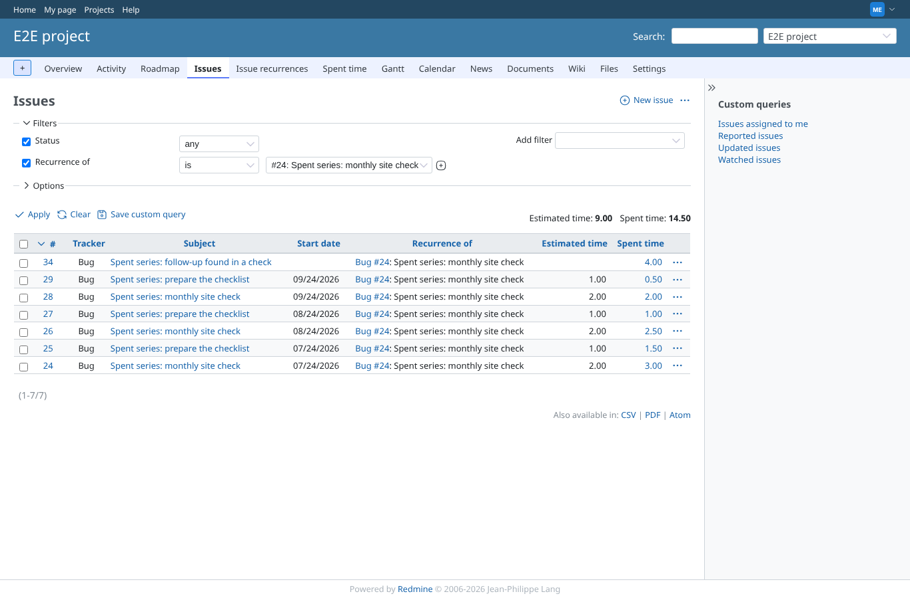 | manager | `/projects/e2e-project/issues?set_filter=1&f[]=status_id&op[status_id]=*&f[]=recurrence_of&op[recurrence_of]==&v[recurrence_of][]=24&c[]=tracker&c[]=subject&c[]=start_date&c[]=recurrence_of&c[]=estimated_hours&c[]=spent_hours&t[]=estimated_hours&t[]=spent_hours` | Issues filtered on one recurring issue: every issue of the series with its estimated and spent time, totals 9.00 and 14.50 |
| 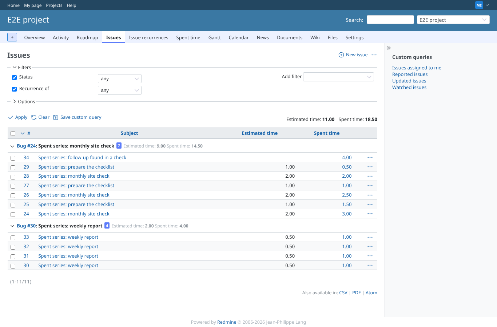 | manager | `/projects/e2e-project/issues?set_filter=1&f[]=status_id&op[status_id]=*&f[]=recurrence_of&op[recurrence_of]=*&c[]=subject&c[]=estimated_hours&c[]=spent_hours&t[]=estimated_hours&t[]=spent_hours&group_by=recurrence_of` | Issues grouped by "Recurrence of": a count and estimated/spent totals per series |
| 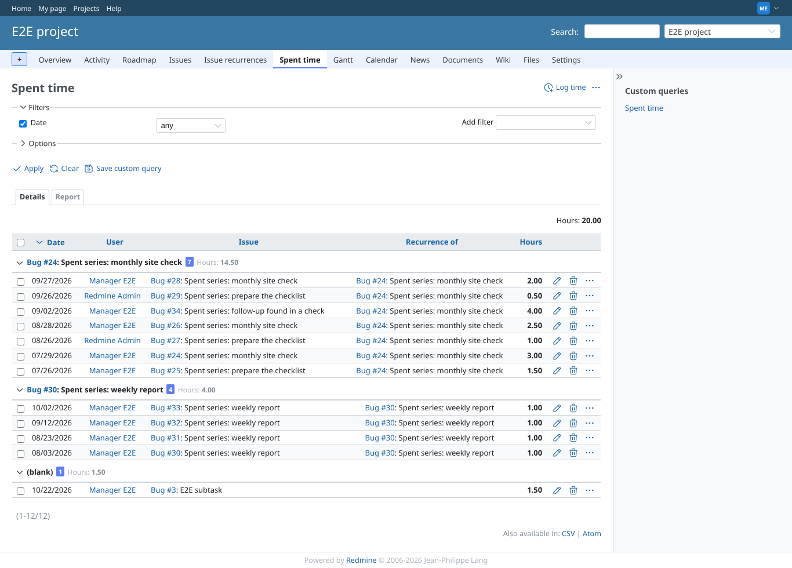 | manager | `/projects/e2e-project/time_entries?set_filter=1&f[]=spent_on&op[spent_on]=*&c[]=spent_on&c[]=user&c[]=issue&c[]=recurrence_of&c[]=hours&t[]=hours&group_by=recurrence_of` | Spent time grouped by "Recurrence of": both series and the time outside any series, with totals |
| 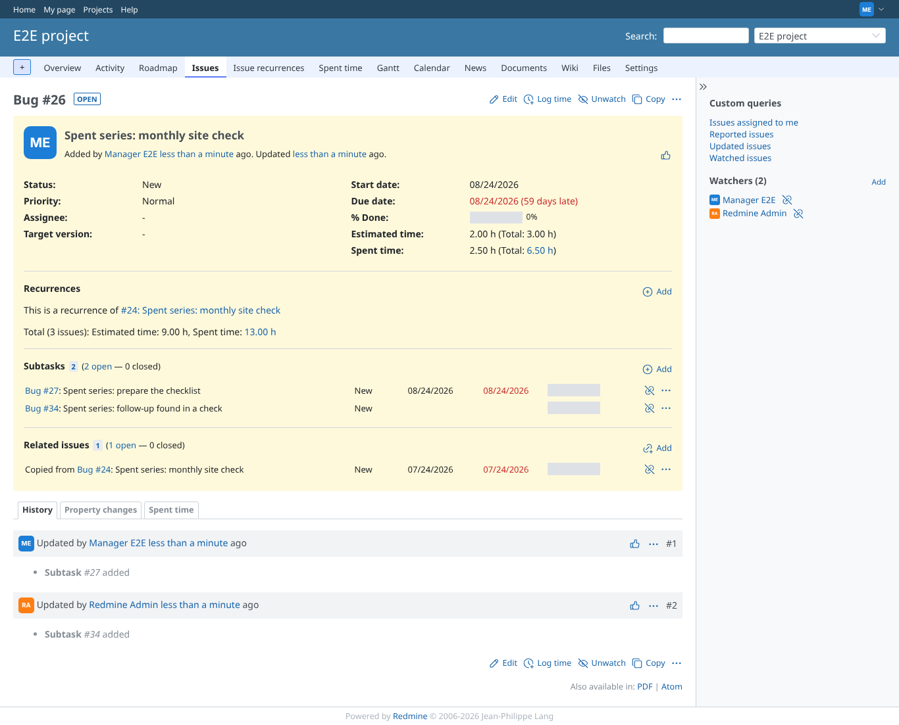 | manager | `/issues/26` | Role limited to own time entries: the series total counts the manager's own 13.00 h, as the list it links to |
| 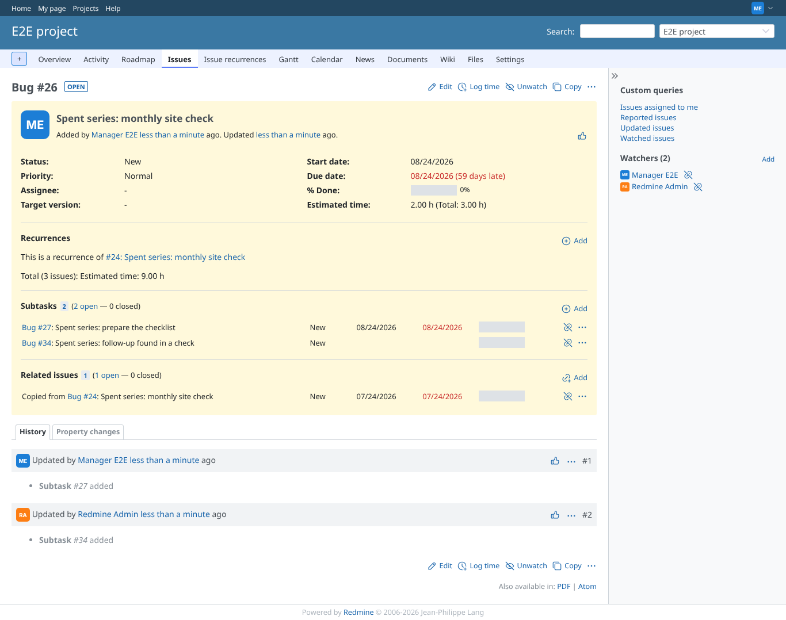 | manager | `/issues/26` | Without "View spent time": the panel shows estimated time only |
| 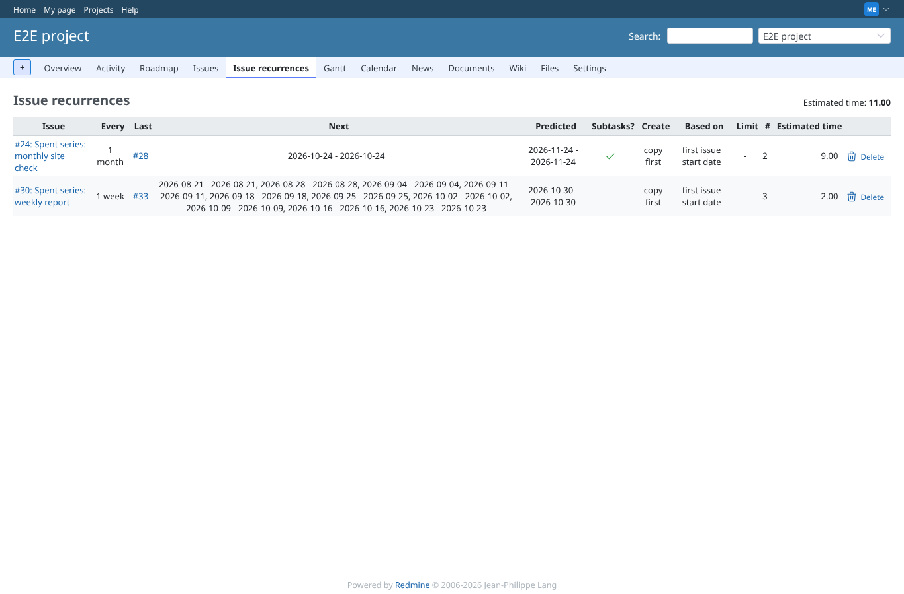 | manager | `/projects/e2e-project/recurrences` | Without "View spent time": no Spent time column and no Report link on the module tab |
| 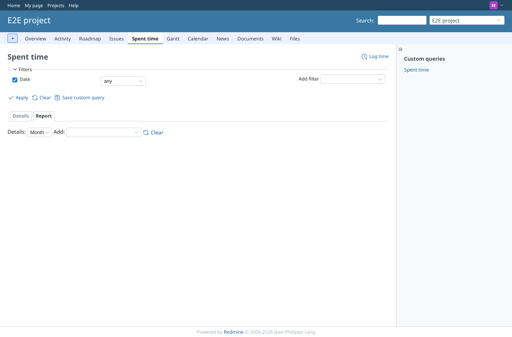 | reporter | `/projects/e2e-project/time_entries/report?criteria[]=recurrence_of&columns=month` | Reporter (no plugin permission): Spent time > Report without the criterion "Recurrence of" |
| 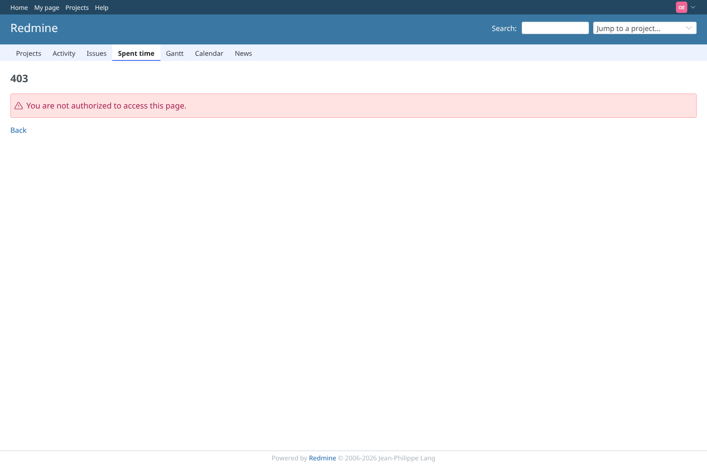 | outsider | `/projects/e2e-private/time_entries?issue.recurrence_of=24` | Outsider: Spent time of the private project is refused (403) |
